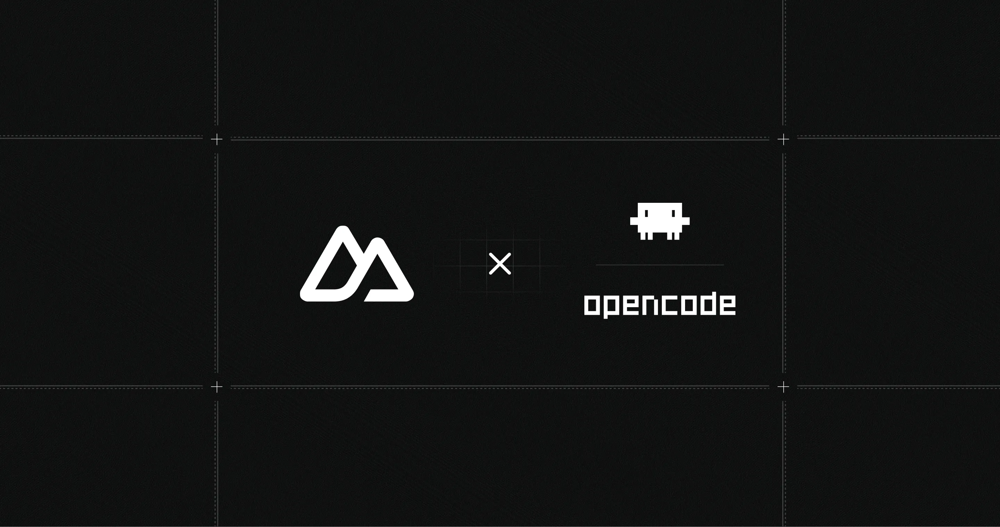

> [!WARNING]
> **nuxt-skills is discontinued.** For 18 days I ran [nuxt-evals](https://nuxt-evals.onmax.me/timeline), more than 100 agent runs on Nuxt and Vue apps. With skills loaded, Opus 5.5 and GPT-6.2 Sol scored lower in 3 of 4 cases, and Opus cost about twice as much per run. The results show the skills no longer improve coding with frontier models, so I've stopped maintaining them. This repository and [nuxt-skill.onmax.me](https://nuxt-skill.onmax.me) stay up to read. [Remove nuxt-skills](#remove-nuxt-skills) says how to take it out of your projects.

<p align="center">
  
  <br>
  <sub>Design inspired by <a href="https://github.com/HugoRCD">HugoRCD</a>'s work</sub>
</p>

<p align="center">Vue, Nuxt, and NuxtHub skills for AI coding assistants.</p>

[](https://nuxt-skill.onmax.me)

<p align="center">
  
  
  
  
  
</p>

<p align="center">
  <a href="https://github.com/nuxt/nuxt/discussions/34059">
    🔗 Related Nuxt RFC: Bundling Agent Skills in Nuxt Modules
  </a>
</p>

## Remove nuxt-skills

| You installed it with                         | Remove it with                                                                                                           |
| --------------------------------------------- | ------------------------------------------------------------------------------------------------------------------------ |
| The Claude Code plugin                        | `/plugin uninstall nuxt-skills@nuxt-skills`, then `/plugin marketplace remove nuxt-skills`                               |
| The Codex plugin                              | `codex plugin remove nuxt-skills@nuxt-skills`, then `codex plugin marketplace remove nuxt-skills`                        |
| `npx skills add onmax/nuxt-skills`            | `npx skills remove onmax/nuxt-skills`, with `-g` if you installed them globally                                          |
| `npx skills add https://nuxt-skill.onmax.me/` | `npx skills remove nuxt`, with `-g` if you installed it globally                                                         |
| A copy by hand                                | Delete the folders you copied, such as `skills/nuxt/`, from `.agents/`, `.claude/`, `.codex/` or your agent's own folder |
| The `nuxt-skill-hub` module                   | The steps below                                                                                                          |

To remove `nuxt-skill-hub` from a Nuxt project:

1. Remove `'nuxt-skill-hub'` from `modules` in `nuxt.config.ts`, and the `skillHub` options if you set any.
2. Remove the package from `package.json`, for example with `npm uninstall nuxt-skill-hub`.
3. Delete the skill folder it wrote, named `nuxt-<your package name>` or `nuxt`, from `.agents/skills/`, `.claude/skills/` or your agent's skills folder. Windsurf keeps it in `.codeium/windsurf/rules/`.
4. If the setup added a hint to `AGENTS.md` or `CLAUDE.md`, delete the lines from `<!-- nuxt-skill-hub:start -->` to `<!-- nuxt-skill-hub:end -->`.

### Get bundled skills from their source

Many skills here were copies from other repositories. Install them from there instead:

- `nuxt-ui`: [nuxt/ui](https://github.com/nuxt/ui/tree/v4/skills/nuxt-ui)
- `nuxt-better-auth`: [nuxt-modules/better-auth](https://github.com/nuxt-modules/better-auth/tree/main/docs/public/.well-known/skills/nuxt-better-auth)
- `comark`: [comarkdown/comark](https://github.com/comarkdown/comark/tree/main/docs/skills/comark)
- `regle`: [victorgarciaesgi/regle](https://github.com/victorgarciaesgi/regle/tree/main/skills/regle)
- `arkenv`: [yamcodes/arkenv](https://github.com/yamcodes/arkenv/tree/v1/skills/arkenv)
- `eve`: [vercel/eve](https://github.com/vercel/eve/tree/main/skills/eve)
- `nanime`: [astraldev/nanime](https://github.com/astraldev/nanime/tree/main/skills/nanime)
- `nuxt-protokit`: [websideproject/nuxt-protokit](https://github.com/websideproject/nuxt-protokit/tree/main/.claude/skills/nuxt-protokit)
- `nuxt-users`: [rrd108/nuxt-users](https://github.com/rrd108/nuxt-users/tree/main/skills/nuxt-users)
- `selaras`: [sewadahapp/selaras](https://github.com/sewadahapp/selaras/tree/master/skills/selaras)
- `yapyak`: [yapyak/yapyak](https://github.com/yapyak/yapyak/tree/main/skills/yapyak)
- `vueuse-functions`: [vueuse/skills](https://github.com/vueuse/skills/tree/main/skills/vueuse-functions)
- `vue`, `nuxt`, `nitro`, `pinia`, `vite`, `vitest`, `unocss`: [antfu/skills](https://github.com/antfu/skills/tree/main/skills)
- `vue-best-practices`, `vue-debug-guides`, `vue-router-best-practices`, `vue-testing-best-practices`: [vuejs-ai/skills](https://github.com/vuejs-ai/skills/tree/main/skills)

> [!NOTE]
> **Sponsored by [Cactus](https://usecactus.app/for-coding-agents?utm_source=github&utm_medium=readme&utm_campaign=nuxt_skills_cactus_test)**
>
> Your agent is working. Don't drift into YouTube. Cactus blocks distracting websites on your Mac during the hours you choose, with a schedule that repeats every week. Built by this repo's maintainer.
>
> [Try Cactus free for 7 days](https://usecactus.app/for-coding-agents?utm_source=github&utm_medium=readme&utm_campaign=nuxt_skills_cactus_test). Keep it for $19.99 USD, paid once. No subscription.

## Other projects

- [Vite Doctor](https://vite-doctor.onmax.me/): Catch framework bugs in Nuxt, Vue, Nitro, and Vite before code review.

## Skills

The complete skill list, including provenance links for every bundled or hand-authored skill, is maintained in the generated [skill catalog](#skill-catalog) below.

The `nuxt-modules` skill includes [template dependency guidance](skills/nuxt-modules/references/template-dependencies.md) covering restart behavior and targeted regeneration, also consumed by Nuxt Skill Hub.

## How Skills Work

Skills follow the [Agent Skills](https://agentskills.io) open format. They can be activated in two ways:

1. **Auto-discovery** — The agent reads each skill's `description` and loads it when relevant to your task
2. **Manual invocation** — Type `/skill-name` (e.g., `/nuxt`) to explicitly load a skill

| You're working on... | Agent may auto-load... |
| -------------------- | ---------------------- |
| `.vue` file          | `vue` skill            |
| `server/api/` route  | `nuxt` skill           |
| `nuxt.config.ts`     | `nuxt` skill           |
| NuxtHub storage      | `nuxthub` skill        |

## Structure

Follows [agentskills](https://github.com/agentskills/agentskills) standard format.

```
nuxt-skills/
├── plugin.json             # Portable Agent Plugins manifest
├── mcp.json                # Portable Nuxt MCP configuration
├── skills/                 # Materialized manual and ecosystem skills
├── packages/nuxt-skill-hub/ # Nuxt module: detects agents, collects skills, writes one skill on `nuxt prepare`
├── docs/                   # nuxt-skill.onmax.me, on @vite-hub/docs
├── ecosystem-skills.json   # Upstream skill sources and selected paths
├── .claude-plugin/         # Claude Code manifest and marketplace metadata
└── .codex-plugin/          # Codex compatibility manifest
```

## Nuxt module skill discovery

The Nuxt-specific sources follow the discovery model used by [Nuxt Skill Hub](https://nuxt-skill.onmax.me/) and its [resolver](https://github.com/onmax/nuxt-skill-hub): prefer a skill shipped by the package, then check the package's `.well-known/skills` publication, then use a repository path or fallback path. Configured sources live in `ecosystem-skills.json`; discovered sources and exact revisions are recorded in `ecosystem-skills.lock.json` so CI can materialize the bundle reproducibly.

## Resources

VueUse maintains its own current skill, so install it directly with `npx skills add vueuse/skills` instead of relying on a generated copy here.

- [Agent Skills Spec](https://agentskills.io) - Open format for extending AI agent capabilities
- [Claude Code Skills](https://code.claude.com/docs/en/skills) - Skills in Claude Code
- [VS Code Agent Skills](https://code.visualstudio.com/docs/copilot/customization/agent-skills) - GitHub Copilot skills in VS Code
- [GitHub Agent Skills Docs](https://docs.github.com/en/copilot/concepts/agents/about-agent-skills) - About agent skills
- [OpenCode Skills](https://opencode.ai/docs/skills/) - Agent skills in OpenCode
- [awesome-copilot](https://github.com/github/awesome-copilot) - Community collection of custom agents and prompts

## Acknowledgments

- **vue** skill gotchas from [vuejs-ai/skills](https://github.com/vuejs-ai/skills) vue-best-practices (200+ rules)
- **vitest** and **vite** skills from [@antfu](https://github.com/antfu)'s [skills](https://github.com/antfu/skills)

## License

MIT

<!-- BEGIN GENERATED SKILL CATALOG -->

## Skill catalog

Every skill in the plugin is listed below with its provenance. The table is regenerated by `pnpm bundle:ecosystem`.

| Skill                                                              | Provenance                                                                                                                                                                                      |
| ------------------------------------------------------------------ | ----------------------------------------------------------------------------------------------------------------------------------------------------------------------------------------------- |
| [`arkenv`](skills/arkenv/)                                         | [Bundled from nuxt-modules/yamcodes/arkenv](https://github.com/yamcodes/arkenv/tree/d7fcbf52804a4f09cbc9a0129b708ae75bb0e830/skills/arkenv)                                                     |
| [`comark`](skills/comark/)                                         | [Bundled from nuxt-modules/comarkdown/comark](https://github.com/comarkdown/comark/tree/f1f23843f0f1636885c5a93dc7d58949a09807a2/docs/skills/comark)                                            |
| [`eve`](skills/eve/)                                               | [Bundled from nuxt-modules/vercel/eve](https://github.com/vercel/eve/tree/35fc0786c1b873a3ce8cdf6372674ee771bdfd52/skills/eve)                                                                  |
| [`nanime`](skills/nanime/)                                         | [Bundled from nuxt-modules/astraldev/nanime](https://github.com/astraldev/nanime/tree/565c81795e5a15c2cf01357b797cbbd3735f209f/skills/nanime)                                                   |
| [`nitro`](skills/nitro/)                                           | [Bundled from antfu/skills](https://github.com/antfu/skills/tree/f63e9ec7bc85f67364b6596c2d29da87e83ce445/skills/nitro)                                                                         |
| [`nuxt`](skills/nuxt/)                                             | [Bundled from antfu/skills](https://github.com/antfu/skills/tree/f63e9ec7bc85f67364b6596c2d29da87e83ce445/skills/nuxt)                                                                          |
| [`nuxt-better-auth`](skills/nuxt-better-auth/)                     | [Bundled from nuxt-modules/nuxt-modules/better-auth](https://github.com/nuxt-modules/better-auth/tree/543feeb4d2b85a5ab553061a634437b70538fa93/docs/public/.well-known/skills/nuxt-better-auth) |
| [`nuxt-content`](skills/nuxt-content/)                             | Manually written in this repository.                                                                                                                                                            |
| [`nuxt-i18n`](skills/nuxt-i18n/)                                   | Manually written in this repository.                                                                                                                                                            |
| [`nuxt-modules`](skills/nuxt-modules/)                             | Manually written in this repository.                                                                                                                                                            |
| [`nuxt-protokit`](skills/nuxt-protokit/)                           | [Bundled from nuxt-modules/websideproject/nuxt-protokit](https://github.com/websideproject/nuxt-protokit/tree/9881d6d9fd0d6667ca3f968487ef4883c500a91e/.claude/skills/nuxt-protokit)            |
| [`nuxt-seo`](skills/nuxt-seo/)                                     | Manually written in this repository.                                                                                                                                                            |
| [`nuxt-studio`](skills/nuxt-studio/)                               | Manually written in this repository.                                                                                                                                                            |
| [`nuxt-ui`](skills/nuxt-ui/)                                       | [Bundled from nuxt-modules/nuxt/ui](https://github.com/nuxt/ui/tree/a11f0327cc374c2e5f8694db6aa0a7ddc6a028f8/skills/nuxt-ui)                                                                    |
| [`nuxt-users`](skills/nuxt-users/)                                 | [Bundled from nuxt-modules/rrd108/nuxt-users](https://github.com/rrd108/nuxt-users/tree/ace4a22820a1b1a28951cf1819148c260f841df6/skills/nuxt-users)                                             |
| [`nuxthub`](skills/nuxthub/)                                       | Manually written in this repository.                                                                                                                                                            |
| [`pinia`](skills/pinia/)                                           | [Bundled from antfu/skills](https://github.com/antfu/skills/tree/f63e9ec7bc85f67364b6596c2d29da87e83ce445/skills/pinia)                                                                         |
| [`regle`](skills/regle/)                                           | [Bundled from nuxt-modules/victorgarciaesgi/regle](https://github.com/victorgarciaesgi/regle/tree/c2668d6f02ec414bdf01609f323fbdbd6036c838/skills/regle)                                        |
| [`reka-ui`](skills/reka-ui/)                                       | Manually written in this repository.                                                                                                                                                            |
| [`selaras`](skills/selaras/)                                       | [Bundled from nuxt-modules/sewadahapp/selaras](https://github.com/sewadahapp/selaras/tree/2b36f258885115156f6207a8be8b9173ceb3bdd3/skills/selaras)                                              |
| [`unocss`](skills/unocss/)                                         | [Bundled from antfu/skills](https://github.com/antfu/skills/tree/f63e9ec7bc85f67364b6596c2d29da87e83ce445/skills/unocss)                                                                        |
| [`vite`](skills/vite/)                                             | [Bundled from antfu/skills](https://github.com/antfu/skills/tree/f63e9ec7bc85f67364b6596c2d29da87e83ce445/skills/vite)                                                                          |
| [`vitest`](skills/vitest/)                                         | [Bundled from antfu/skills](https://github.com/antfu/skills/tree/f63e9ec7bc85f67364b6596c2d29da87e83ce445/skills/vitest)                                                                        |
| [`vue`](skills/vue/)                                               | [Bundled from antfu/skills](https://github.com/antfu/skills/tree/f63e9ec7bc85f67364b6596c2d29da87e83ce445/skills/vue), description set in `ecosystem-skills.json`                               |
| [`vue-best-practices`](skills/vue-best-practices/)                 | [Bundled from vuejs-ai/skills](https://github.com/vuejs-ai/skills/tree/198f0cd8f7f9c0a3d9b566ccc16de6677519ee78/skills/vue-best-practices), description set in `ecosystem-skills.json`          |
| [`vue-debug-guides`](skills/vue-debug-guides/)                     | [Bundled from vuejs-ai/skills](https://github.com/vuejs-ai/skills/tree/198f0cd8f7f9c0a3d9b566ccc16de6677519ee78/skills/vue-debug-guides)                                                        |
| [`vue-router-best-practices`](skills/vue-router-best-practices/)   | [Bundled from vuejs-ai/skills](https://github.com/vuejs-ai/skills/tree/198f0cd8f7f9c0a3d9b566ccc16de6677519ee78/skills/vue-router-best-practices), description set in `ecosystem-skills.json`   |
| [`vue-testing-best-practices`](skills/vue-testing-best-practices/) | [Bundled from vuejs-ai/skills](https://github.com/vuejs-ai/skills/tree/198f0cd8f7f9c0a3d9b566ccc16de6677519ee78/skills/vue-testing-best-practices)                                              |
| [`vueuse-functions`](skills/vueuse-functions/)                     | [Bundled from vueuse/skills](https://github.com/vueuse/skills/tree/004812b4aa0815f5745ac30a6a7dc4927aec7b3d/skills/vueuse-functions)                                                            |
| [`yapyak`](skills/yapyak/)                                         | [Bundled from nuxt-modules/yapyak/yapyak](https://github.com/yapyak/yapyak/tree/b13a8973948c25fb733d44d94084827147c63feb/skills/yapyak)                                                         |

<!-- END GENERATED SKILL CATALOG -->
